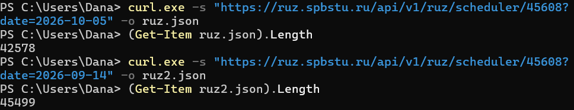
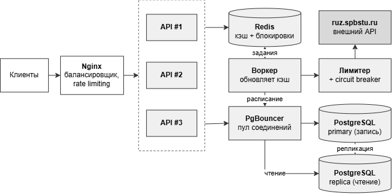

# software_construction_ScheduleSPbSTU
ScheduleSPbSTU — персональный трекер расписания, планировщик задач и заметок для студента

# Конструирование программного обеспечения

---

### Участники команды

| ФИО |
| --- |
| Есько Дана |
| Пшеницына Юлия |
| Кузминых Ульяна |

---

## ЭТАП 1:  **Подготовительный этап & Общие требования**

**Тема проекта:** <u>ScheduleSPbSTU</u> — персональный трекер расписания, планировщик задач и заметок конспектов для студента.

**Суть проблемы:** Студенты вынуждены держать расписание занятий, дедлайны по учебным задачам и конспекты в разных, не связанных между собой местах (сайт вуза, заметки, мессенджеры), из-за чего теряют дедлайны и тратят время на поиск нужной информации перед парой.

**Стек:**

- **Backend:** Go
- **База данных:** PostgreSQL
- **Frontend:** Desktop-приложение на React
- **Внешний API:** ruz.spbstu.ru — открытый сервис расписания СПбПУ
- **Развёртывание:** Docker Compose
- **Архитектура:** клиент-серверная

**Основные функции:**

- просмотр расписания занятий по дням/неделям, автоматически подтягивается через ruz.spbstu.ru;
- кэширование расписания в PostgreSQL — при недоступности внешнего API приложение показывает последнюю сохранённую версию (закрывает требование по Fault Tolerance);
- планер учебных задач: создание, дедлайны, статусы («Запланировано» / «В процессе» / «Выполнено»);
- заметки по предметам: создание, редактирование, привязка к конкретному занятию, поиск;
- главный экран с ближайшими парами, дедлайнами и последними конспектами.

## ЭТАП 2: Выработка требований

### 2.1 Сценарии:

#### 1. Просмотр расписания

<aside>
💡

Как студент, я хочу просматривать расписание занятий по дням и неделям.

</aside>

> 
> 
> 1. Студент открывает приложение.
> 2. Студент выбирает свою группу из общей базы.
> 3. Система загружает расписание из внешнего API.
> 4. Полученные данные сохраняются в локальном кэше.
> 5. Студент выбирает нужную дату или неделю.
> 6. Система отображает список занятий (название предмета, дата, время, преподаватель и аудитория)
> 
> Альтернативный сценарий: если внешний API недоступен, система показывает последнюю сохранённую версию расписания и уведомляет пользователя, что данные могут быть неактуальными.
> 

#### 2. Создание учебной задачи

<aside>
💡

Как студент, я хочу создавать задачи с дедлайнами, чтобы не забывать о выполнении лабораторных работ.

</aside>

> 
> 
> 1. Студент открывает приложение.
> 2. Студент открывает раздел задач.
> 3. Нажимает кнопку «Создать задачу».
> 4. Заполняет название, описание и срок выполнения.
> 5. Сохраняет задачу.
> 6. Система проверяет введённые данные и добавляет задачу в базу данных.

#### 3. Изменение статуса задачи

<aside>
💡

Как студент, я хочу менять статус задачи, чтобы отслеживать прогресс выполнения работ.

</aside>

> 
> 
> 1. Студент открывает приложение.
> 2. Студент открывает список задач.
> 3. Выбирает нужную задачу.
> 4. Изменяет её статус («Запланировано» / «В процессе» / «Выполнено»).
> 5. Система сохраняет изменения.
> 6. Обновлённый статус отображается в списке и на главном экране.
> 7. Приходит уведомление в тг/почту о изменении статуса задачи.

#### 4. Создание заметки по дисциплине

<aside>
💡

Как студент, я хочу создавать заметки по учебным предметам, чтобы хранить конспекты в одном месте.

</aside>

> 
> 
> 1. Студент открывает приложение.
> 2. Студент открывает раздел заметок.
> 3. Нажимает кнопку «Создать заметку».
> 4. Указывает заголовок и текст заметки.
> 5. Привязывает заметку к дисциплине или конкретному занятию.
> 6. Сохраняет заметку.

### 2.2. Масштаб системы

| Параметр | Значение |
| --- | --- |
| DAU (уникальных пользователей в сутки) | 10 000 |
| Зарегистрированных пользователей | до 50 000 за 5 лет |
| Целевой запас при росте | ×10, то есть 100 000 DAU |

### 2.3 Отказоустойчивости

При обращении к `ruz.spbstu.ru` система должна работать по следующему алгоритму:

> 
> 
> 1. Ищем расписание группы и недели в таблице.
> 2. Если запись **свежая** (младше 30 минут) — возвращаем её без обращения к ruz.
> 3. Если записи нет или она устарела — пробуем получить свежие данные у ruz.
> 4. Если внешний API ответил успешно, сохранить новый результат в базу данных.
> 5. Если внешний API недоступен, вернуть последнюю сохранённую версию.
> 6. Показать пользователю уведомление о том, что используются кэшированные данные.
> 7. После нескольких последовательных ошибок временно прекратить новые запросы к API.
> 8. Через заданный интервал выполнить повторную попытку.

| Состояние кэша | Возраст | Поведение |
| --- | --- | --- |
| Свежий | до 30 мин | отдаём кэш |
| Устаревший | 30 мин – 7 суток | пробуем обновить; при сбое отдаём кэш с предупреждением |
| Слишком старый | более 7 суток | при сбое возвращаем ошибку 503 |

Целевая нагрузка — **10 000** уникальных пользователей в сутки (DAU). 
Трафик ≈ 1,3 ГБ в сутки, объём данных за 5 лет ≈ 50 ГБ. 

```verilog
В сутки:  10 000 × 25 = 250 000 запросов
В секунду (среднее): 200 000 / 86 400 ≈ 2,3
В пик: 2,3 × 5 ≈ 12
```

## ЭТАП 3: Выработка требований

### 3.1 Анализ нагрузок

#### Расчет соотношения Read/Write нагрузки

| Действие | Тип | Раз в сутки |
| --- | --- | --- |
| Открытие главного экрана | Read | 5 |
| Просмотр расписания (день/неделя) | Read | 6 |
| Просмотр списка задач | Read | 3 |
| Просмотр и поиск заметок | Read | 6 |
| **Итого чтений** |  | **20** |
| Создание задачи | Write | 1 |
| Смена статуса задачи | Write | 2 |
| Создание или правка заметки | Write | 2 |
| **Итого записей** |  | **5** |

Read/write: 20 чтений и 5 записей, то есть **4 : 1**. Чтений в четыре раза больше, значит система read-heavy. Отсюда практический вывод: нужно ускорять именно чтения (кэш, индексы).

**Расчёт при DAU = 10 000:**

- Чтений в сутки: 10 000 × 20 = **200 000**
- Записей в сутки: 10 000 × 5 = **50 000**
- Всего: **250 000** запросов в сутки
- **Read : Write = 200 000 : 50 000 = 4 : 1**
- Средняя нагрузка за сутки: 250 000 / 86 400 ≈ **2,9 RPS**

Студенты заходят в приложение в основном утром перед парами и вечером. Принимаем, что 80 % запросов приходится на 6 часов в сутки:

- 0,8 × 250 000 / (6 × 3600) ≈ 9,3 RPS — среднее в активное окно
- Пик внутри окна ×1,5 ≈ **14 RPS** (из них ~11 чтений и ~3 записи)

Для расчёта берём **пик 15 RPS**. При росте ×10 — **150 RPS**.

#### Расчет объемов сетевого трафика

| Запрос | Размер ответа |
| --- | --- |
| Главный экран | 8 КБ |
| Расписание на неделю (компактный ответ нашего API; сырой ответ ruz — ≈ 44 КБ) | 15 КБ |
| Список задач | 5 КБ |
| Список заметок | 10 КБ |
| Среднее чтение | ≈ 10 КБ (запрос ≈ 0,5 КБ) |
| Запись: запрос ≈ 2 КБ (текст заметки), ответ ≈ 0,5 КБ |  |

**За сутки:**

- Исходящий: 200 000 × 10 КБ + 50 000 × 0,5 КБ ≈ 2,0 ГБ
- Входящий: 200 000 × 0,5 КБ + 50 000 × 2 КБ ≈ 0,2 ГБ

**В пик:**

- Исходящий: 11 RPS × 10 КБ = 110 КБ/с ≈ **0,9 Мбит/с**
- Входящий: ≈ 0,1 Мбит/с

**Трафик к внешнему API.** Благодаря кэшу он не зависит от числа пользователей, а зависит только от числа **групп**. Допущение: в СПбПУ порядка 1000 групп. Худший случай: каждая группа, 2 недели, обновление раз в 30 мин: 1000 × 2 × 48 ≈ 96 000 запросов/сутки ≈ 1,1 RPS в среднем; при 44 КБ на ответ это ≈ 4,2 ГБ входящего трафика в сутки, то есть ≈ 0,4 Мбит/с. Фактически значительно меньше, так как активна лишь часть групп. При ×10 нагрузка на ruz не растёт.

#### Расчет объемов дисковой системы с учетом **требования по хранению данных за период > 5 лет**.

**Допущения по размеру строки** (с учётом служебных данных PostgreSQL и индексов):

|  | Строк в сутки | Размер строки |
| --- | --- | --- |
| `users` | ~30 новых | 250 Б |
| `tasks` (1 новая на DAU) | 10 000 | 700 Б |
| `notes` (1 новая на DAU) | 10 000 | 6,5 КБ (текст 4 КБ + служебные 0,5 КБ + полнотекстовый индекс 2 КБ) |
| `schedule_cache` | — | ≈ 44 КБ на группу и неделю (измерено, см. ниже) |

**Расчёт на год:**

- `users`: 50 000 × 250 Б ≈ 12,5 МБ
- `tasks`: 10 000 × 365 × 700 Б ≈ **2,6 ГБ**
- `notes`: 10 000 × 365 × 6,5 КБ ≈ **23,7 ГБ**
- `schedule_cache`: 1000 групп × 52 недели × 44 КБ ≈ **2,3 ГБ** (если хранить все недели и не удалять старые)

| Период | tasks | notes | schedule_cache | **Итого** |
| --- | --- | --- | --- | --- |
| 1 год | 2,6 ГБ | 23,7 ГБ | 2,3 ГБ | **≈ 28,6 ГБ** |
| 3 года | 7,7 ГБ | 71,2 ГБ | 6,9 ГБ | **≈ 86 ГБ** |
| 5 лет | 12,8 ГБ | 118,6 ГБ | 11,5 ГБ | **≈ 143 ГБ** |

Размер строки `schedule_cache` — единственная величина, которую можно было измерить до написания кода, поэтому она взята не из допущения, а из реального ответа ruz. Запрос расписания группы 45608:

```verilog
curl.exe -s "[https://ruz.spbstu.ru/api/v1/ruz/scheduler/45608?date=2026-10-05](https://ruz.spbstu.ru/api/v1/ruz/scheduler/45608?date=2026-10-05)" -o ruz.json
(Get-Item ruz.json).Length
```



| Неделя | Размер ответа |
| --- | --- |
| 2026-10-05 | 42 578 Б |
| 2026-09-14 | 45 499 Б |
| Среднее | ≈ 44 КБ |

**Вывод:** на 5+ лет достаточно диска **300 ГБ SSD** (запас ×2 на рост таблиц, WAL и резервные копии). При ×10 получаем ≈ 1,3 ТБ (кэш расписания не растёт: число групп остаётся прежним) — потребуется секционирование. Большая часть объёма приходится на заметки, поэтому именно они — первый кандидат на оптимизацию.

### 3.2 **Архитектурные схемы**

#### Уровень 1 — Context


#### Уровень 2 — Container


### 3.3 **Контракты API**

(реализация запросов при помощи swagger)

 Примеры запросов и ответов с различными кодами для регистрации нового пользователя в системе


Примеры запросов и ответов с различными кодами для входа


### 3.4 **Проектирование данных**


**Почему заметка не ссылается на занятие внешним ключом.** Идентификаторы занятий в ruz могут меняться при перезагрузке расписания. Поэтому привязка хранится как «предмет + дата + время начала»: она переживает обновление кэша.

| Таблица | Индекс | Какой запрос ускоряет |
| --- | --- | --- |
| `users` | UNIQUE (`email`) | вход по e-mail |
| `schedule_cache` | PK (`group_id`, `week_start`) | поиск расписания: чтение одной строки по ключу |
| `tasks` | (`user_id`, `status`, `deadline`) | список задач пользователя, фильтр по статусу, ближайшие дедлайны |
| `notes` | (`user_id`, `updated_at` DESC) | последние заметки пользователя |
| `notes` | (`user_id`, `subject_name`) | заметки по предмету |
| `notes` | GIN (`tsv`) | полнотекстовый поиск |

**Обоснование.**

1. **Все запросы пользователя ограничены его `user_id`.** За 5 лет у одного человека набирается порядка сотен задач и заметок, а не миллионы. Индекс сразу сужает выборку до нескольких сотен строк, поэтому запрос выполняется за единицы миллисекунд, независимо от общего размера таблицы (до ~18 млн строк `notes` за 5 лет).
2. **Расписание читается по первичному ключу** — это одна строка, выборка за доли миллисекунды.
3. **Нагрузка на БД мала:** пик 15 RPS, из них ~3 записи. Одна инстанция PostgreSQL обрабатывает на порядки больше.
4. **Полнотекстовый поиск** (`tsvector` + GIN, конфигурация `russian`) не сканирует таблицу целиком; пользовательский фильтр применяется вместе с индексом.
5. **Запись заметок дешёвая:** `tsv` вычисляется автоматически, правки идут в одну строку.

Миграции накатываются автоматически при старте (каталог `migrations/`, нумерованные SQL-файлы).

### 3.5 **Масштабирование**



| Проблема при ×10 | Решение |
| --- | --- |
| 150 RPS на один процесс API | **Горизонтальное масштабирование**: несколько stateless-экземпляров Go-сервера за Nginx. Состояния в процессе нет (JWT, а не серверные сессии), поэтому добавлять экземпляры просто |
| Блокировка со стороны ruz | **Общий кэш в Redis** (TTL 30 мин, у популярных групп можно увеличить до 2 ч) + **single-flight** на ключ «группа+неделя» + **фоновый воркер**, заранее обновляющий расписание активных групп. Число запросов к ruz ограничено числом групп (~1000), а не числом пользователей; Circuit Breaker и rate limiting до ruz остаются |
| Рост чтений из БД | **Реплика PostgreSQL** для чтений (списки, поиск, главный экран); запись остаётся на primary |
| Много соединений с БД от нескольких API | **PgBouncer** — пул соединений |
| Таблицы `notes` и `tasks` ≈ 1,3 ТБ за 5 лет | **Секционирование** `notes` и `tasks` по хэшу `user_id` (например, 16 секций) или по времени создания; архивирование старых данных |
| Аномальные клиенты | **Rate limiting** на Nginx (например, 20 запросов/с с одного IP) |
| Пиковая нагрузка | Автомасштабирование числа экземпляров API по CPU |

Пересчёт ресурсов: ≈ 20 ГБ исходящего трафика в сутки (10 Мбит/с в пик), ≈ 1,3 ТБ данных за 5 лет, три экземпляра API с запасом на отказ одного.

### `groups` (справочник групп)

| Столбец | Тип | Зачем и почему такой тип |
| --- | --- | --- |
| `id` | integer, PK | **тот же id, что в ruz** (например, 45608). Собственный id не нужен, и не нужна таблица соответствия «наш id ↔ id ruz» |
| `name` | text | название группы |
| `faculty_id`, `faculty_name` | integer, text | институт группы (для эндпоинтов `/faculties`, `/faculties/{id}/groups`) |
| `synced_at` | timestamptz | когда справочник последний раз обновляли из ruz |

### `users`

| Столбец | Тип | Зачем и почему такой тип |
| --- | --- | --- |
| `id` | **uuid**, PK | случайный идентификатор. Его нельзя угадать перебором, в отличие от 1, 2, 3, и его безопасно класть в JWT |
| `email` | text, **UK** | логин. UK (unique key) запрещает двух пользователей с одним e-mail, это и даёт ответ **409** при регистрации |
| `password_hash` | text | **хеш** пароля (bcrypt или argon2), а не сам пароль. При утечке базы пароли напрямую не раскрыть |
| `group_id` | integer, FK → groups | выбранная группа. **Может быть пустым (NULL)**: при регистрации передаются только email и пароль, а группа выбирается позже через `PUT /me/group` |
| `created_at` | timestamptz | дата регистрации |

### `tasks`

| Столбец | Тип | Зачем |
| --- | --- | --- |
| `id` | bigint, PK | автоматически нарастающий номер |
| `user_id` | uuid, FK → users | чья задача |
| `title`, `description` | text | название и описание |
| `deadline` | timestamptz | срок (в сценарии 2 он обязателен) |
| `status` | text | `planned` / `in_progress` / `done` |
| `subject_name` | text | к какому предмету относится |
| `created_at`, `updated_at` | timestamptz | когда создана и когда изменена |

### `notes`

| Столбец | Тип | Зачем |
| --- | --- | --- |
| `id`, `user_id` | bigint PK, uuid FK | как у задач |
| `title`, `body` | text | заголовок и текст |
| `subject_name` | text | дисциплина |
| `lesson_date`, `lesson_start` | date, time | привязка к конкретному занятию |
| `tsv` | tsvector | слепок текста для полнотекстового поиска |
| `created_at`, `updated_at` | timestamptz |  |

### `schedule_cache`

| Столбец | Тип | Зачем |
| --- | --- | --- |
| `group_id` | integer, FK | чья группа |
| `week_start` | date | понедельник недели |
| `payload` | **jsonb** | сырой ответ ruz целиком |
| `fetched_at` | timestamptz | когда получили. Именно по нему считается «свежий (младше 30 минут) или устаревший» |
